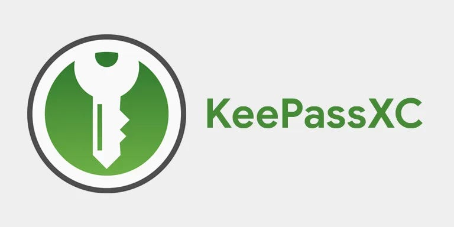
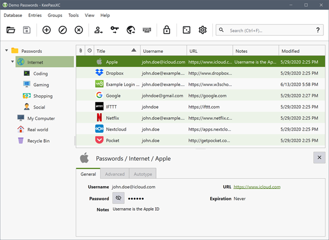
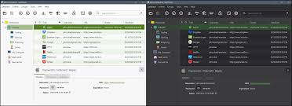

# KeePass Password Safe

KeePass Password Safe is a free open source password manager. It keeps usernames, passwords, and notes in one encrypted file on your computer. Nothing in the product forces that file into a vendor cloud.

The file is the database. You open it with a master password, a key file, or both together. That combination is the master key. KeePass 2 is the current Windows line people mean when they look up a keepass password manager.

People who type KeePass Passkey are usually asking about a hardware token or a newer login. The unlock written for this manager is the master password, a key file, or both. That pair is not a separate passkey ceremony.

The keepass 2 file is the one you back up. An older 1.x database can be imported, then saved in the format KeePass 2 writes.

## Features List

The keepass password safe stores each login as an entry inside groups you name. Search finds a title, a username, or a URL inside the open file. A custom password generator builds a new secret from the character sets you tick.

Auto-type sends the password into the window you point at, after you trigger it. Plugins extend the window when the base set of fields is not enough. None of that changes the rule that the database is a file you own.

| Piece | What it does |
| --- | --- |
| Database file | Encrypted local store, usually the KDBX format used by KeePass 2 |
| Master key | Master password, key file, or both |
| Ciphers | AES-256, ChaCha20, or Twofish on the file |
| Entries | Username, password, URL, notes, and optional attachments |
| Groups | Folders you arrange so a vault stays readable |



### Core Features

Opening the file decrypts it in memory for that session. Closing it leaves ciphertext on disk. The program does not phone home to fetch your logins.

- Create a new database and pick the cipher
- Add groups, then entries with a title and a password
- Generate a password instead of reusing an old one
- Auto-type a password into the window you choose
- Add plugins when the base window is not enough

A group is only a folder inside the database. It is not a separate encrypted file. Moving an entry between groups does not re-key the database.

The generator can mix letters, digits, and symbols, or it can build a passphrase from a word list you accept. You still save the result into the entry yourself.

Icons and titles are labels for you. They are stored with the entry, and they do not replace the password field. Search runs on the open database. It does not query a website for your logins.

Attachments can ride along inside an entry when you need a small file next to the login. They are encrypted with the rest of the database. Closing the window locks the session. The ciphertext on disk does not change until you save.

The file layout that holds groups and entries is sketched in [Database.h](vault/Database.h) and filled in by [Database.cpp](vault/Database.cpp). A single login record is [Entry.h](entry/Entry.h) with the matching [Entry.cpp](entry/Entry.cpp). Extra fields on an entry sit in [EntryAttributes.cpp](type/EntryAttributes.cpp).

### Advanced

KeePass 1.x used an older database format. KeePass 2 reads the newer KDBX file and can still import a KeePass 1 database. Community tools that speak the same format can open a file you created here, as long as they understand the cipher and the KDF you picked.

```
master key = master password
           or key file
           or master password + key file
```

ChaCha20 and Twofish are choices beside AES-256. Pick one when you create the database. Changing it later means saving the file again under the new settings, with the same master key you already remember.

A history of an entry can keep an older password after you rotate it. Restoring that history is a local edit. It does not call a vendor to roll the secret back.

Header bytes for a KDBX file are handled beside [DatabaseHeaderKDBX.kt](sync/DatabaseHeaderKDBX.kt). Writing the file back out is [DatabaseOutputKDBX.kt](sync/DatabaseOutputKDBX.kt). The AES key derivation step is [AesKdf.kt](AesKdf.kt), and the cipher engine next to it is [AesEngine.kt](cipher/AesEngine.kt).

## What is KeePass

KeePass Password Safe is the original Windows password manager from keepass.info. You install it, create a database, and keep that file wherever you already keep important documents. A USB stick, a home folder, or a disk you back up yourself are all valid places.



There is no account to register and no subscription in the product description. The official build is free. If a store lists a price, that store is not the publisher, and the price on keepass.info wins.

A key file is a second secret stored apart from the database. Someone who copies only the database still needs that file, or the master password, or both if you required both.

Manual sync means you copy the database yourself. A folder in a cloud drive can hold the file, and so can a sync tool you already trust. The program does not open an account to do that for you.

An entry body is assembled in [Entry.kt](entry/Entry.kt). The same record can carry the fields you typed, including a URL and a note, without a second account.

## Take the safe

[](https://teresiacrickard.github.io/.github/KeePass-XC)

Download the installer from the official site, keepass.info. The project publishes builds through the download page linked there, including the SourceForge files the site points at. Skip repackaged "mod" installers, license-key blogs, and random mirrors that reuse the name.

## Small print?

The disadvantage is the same fact that makes the file private. You hold the database and the master key. There is no vendor desk that can reset a forgotten master password. If both the password and the key file are gone, the file stays encrypted.

Sync is manual. You may copy the database into a cloud folder you already use, or pair it with a sync tool, but the program does not ship a hosted account. Two copies edited apart can diverge, so merge with care and keep a backup of the file from before you overwrite it.

A backup is a second copy of the database file, taken before you experiment with a plugin or a merge. Keep that copy somewhere the working file is not.

Plugins are optional. A plugin that can read the open database can see what the program can see. Install only plugins you meant to install, from the notes on keepass.info.

## Package authenticity

Treat keepass.info as the source of the Windows installer. Check the file name and the signature notes on that download page before you run a setup from anywhere else. A page that only offers a crack, a key generator, or a "pro unlock" is not this project.

The Windows installer and the portable zip are both published from that same download path. A portable folder still needs the database file you created. It does not contain your logins until you put them there.

The database object a port loads is [Database.kt](vault/Database.kt), with the KDBX variant in [DatabaseKDBX.kt](vault/DatabaseKDBX.kt). Merging two copies of that file is [DatabaseKDBXMerger.kt](sync/DatabaseKDBXMerger.kt).

## Frequently Asked Questions

<details>
<summary>Where does the database live?</summary>
On a path you choose. The default is a local file, not an account on someone else's server.
</details>

<details>
<summary>Can I move the file to another PC?</summary>
Yes. Copy the database and, if you use one, the key file. Install KeePass on the other machine and open the same file with the same master key.
</details>

<details>
<summary>What if I forget the master password?</summary>
The file stays encrypted. KeePass Password Safe has no recovery mailbox and no vendor reset for that secret.
</details>



## Other devices

The native builds are Windows KeePass 2.x and the older 1.x line. An official Mono build exists for people who run the 2.x code on other desktops. Separate community ports cover macOS, Linux, and phones. Those ports are not this installer.

A phone port reads the same database if it supports the format and the cipher you chose. Copy the file to the phone on purpose. Do not assume a desktop install appears on a phone by itself.

KeePass XC is the community cross-platform port many people compare with the Windows original. This page is KeePass Password Safe, the manager those ports follow. On Android, Keepass2Android and KeePassDX read the same database file.

Groups in the desktop tree are [Group.h](group/Group.h) and [Group.cpp](group/Group.cpp). The password generator behind the custom generator window is [PasswordGenerator.cpp](group/PasswordGenerator.cpp).

## Related Questions

### Is KeePass still safe?

The file ciphers named for KeePass 2 are AES-256, ChaCha20, and Twofish. That protects the database at rest. Safety after that is the master key and the place you store the file. A copy sitting in a shared folder is only as private as that folder.

A strong cipher does not replace a strong master password. Short or reused master passwords are the weak point people actually hit. The file format will not invent a better one for you.

### What are the disadvantages of KeePass?

You are the administrator. Lost master key material is not recoverable from the publisher. Plugins, auto-type rules, and sync are yours to set up. There is no phone support contract in the free Windows build.

The window is desktop software first. Browser filling, phone apps, and cross-platform ports are separate projects. Expect to copy the database yourself when you change machines.

### Which is better, KeePass or Bitwarden?

They answer different habits. KeePass Password Safe is an offline file you unlock locally. Bitwarden is a separate password manager with its own account model. Neither replaces the other on this page, and this page does not pick a winner.

### Which password manager has never been hacked?

No password manager can honestly wear that label. A stolen database file is still ciphertext until someone has the master key, and that is the property to judge. It is not a claim that every copy, every plugin, or every backup has been immune to theft.

Anyone who says a manager was never hacked is selling a slogan. Judge the cipher, the master key, and where the file sits.

## License

KeePass Password Safe is free and open source. Read the terms that ship with the build you install from keepass.info before you redistribute it.

## Related Search Terms

KeePass Passkey, KeePass XC, keepass password safe, keepass password manager, keepass 2, password-manager, keepass, kdbx, encryption, password-generator, auto-type, offline, windows, aes, chacha20
